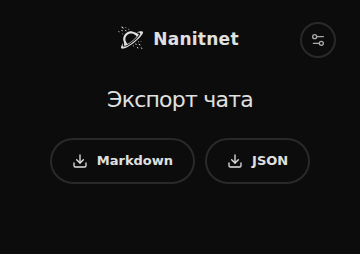
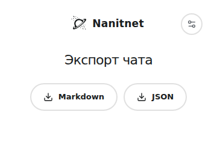

# ChatGPT Export by Nanitnet

Расширение для Firefox и Chrome: экспорт открытой переписки с **chatgpt.com**
в **Markdown** и **JSON**. Без сервера разработчика, аналитики и внешних зависимостей
в коде расширения. Интерфейс — на русском, со светлой и тёмной темами.

[Скачать последнюю версию](https://github.com/Nanitnet/ChatGPT-Export-by-Nanitnet/releases/latest)

| Тёмная тема | Светлая тема |
| --- | --- |
|  |  |

## Возможности

- Прямой экспорт через текущую сессию ChatGPT, без прокрутки страницы.
- Дополнительный режим с прокруткой и подгрузкой сообщений.
- Экспорт текущей ветки: порядок, повторяющиеся сообщения, текст и код сохраняются.
- Markdown из ответа сервера; JSON с ролями, текстом, метками времени, если доступны,
  и сведениями о полноте экспорта.
- Получение переписки продолжается при закрытом окне расширения. Готовый снимок
  можно скачать в обоих форматах до перезагрузки вкладки.
- Настройки темы, отмена, повторный сбор и диагностика.

## Установка

### Firefox 140+

1. Скачайте `chatgpt-local-export-firefox-0.4.0.zip` из
   [релиза v0.4.0](https://github.com/Nanitnet/ChatGPT-Export-by-Nanitnet/releases/tag/v0.4.0).
2. Откройте `about:debugging#/runtime/this-firefox`.
3. Нажмите «Загрузить временное дополнение» и выберите ZIP.

Это исходная неподписанная сборка: временная установка действует до перезапуска
Firefox. Для постоянной установки в обычном Firefox требуется подпись Mozilla.

### Chrome / Chromium 109+

1. Скачайте `chatgpt-local-export-chrome-0.4.0.zip` из того же релиза и распакуйте.
2. Откройте `chrome://extensions` и включите «Режим разработчика».
3. Нажмите «Загрузить распакованное расширение» и выберите папку с `manifest.json`.

## Использование

Откройте сохранённый чат на **chatgpt.com**, нажмите значок расширения и выберите
**Markdown** или **JSON**. В адресе чата должен присутствовать `/c/<id>`.

По умолчанию используется режим **«Напрямую»**. В настройках можно переключиться
на **«С прокруткой»**, выбрать тему и получить диагностическую сводку. После
обновления расширения перезагрузите вкладку ChatGPT.

## Доступ и приватность

Разрешения — только **`activeTab`** и **`scripting`**. Расширение получает доступ
к выбранной вкладке после нажатия значка, проверяет точный origin `https://chatgpt.com`
и читает только верхний документ. Постоянного доступа ко всем сайтам и фонового
процесса нет.

**Прямой режим использует токен текущей сессии ChatGPT.** Он получает его из
`/api/auth/session` (при необходимости — `/unauth-mweb/auth/session/read-only`)
и выполняет GET `/backend-api/conversation/<id>` на том же сайте. Токен и область
аккаунта используются только для этих запросов в контексте страницы и не попадают
в окно расширения, диагностическую сводку, глобальные переменные или постоянное
хранилище. HTTP-переходы на другой адрес запрещены.

Расширение не читает значения cookies через JavaScript или браузерный API cookies.
Браузер автоматически использует обычную сессию при запросах к ChatGPT. Отсутствие
разрешения `cookies` само по себе не является гарантией безопасности стороннего
расширения: здесь описание основано на опубликованном коде.

Переписка и авторизация **не отправляются сервисам Nanitnet или другим сторонним
сервисам**. Файлы создаются локально через Blob. В постоянное хранилище самого
расширения записывается только предпочтение темы. Снимок чата остаётся в памяти
вкладки до её закрытия или перезагрузки.

В Firefox декларация `authenticationInfo` описывает отправку авторизации обратно
в OpenAI для чтения чата; это не разрешение на доступ к API cookies. Расширение
не меняет политику безопасности chatgpt.com. CSP окна расширения запрещает
сетевые соединения; скрипт API работает в контексте самой страницы.

**Диагностику можно проверить перед отправкой.** Она содержит версию, счётчики,
HTTP-статусы, коды ошибок и разрешённые названия полей/типов. В неё не включаются
текст чата, URL и ID переписки, заголовки авторизации, профиль или токены.
Автоматической отправки диагностики нет. При сообщении об ошибке не прикладывайте
cookies, сессию, токены, HAR или личную переписку.

## Ограничения

Используется внутренний, неофициальный API chatgpt.com. Его адреса и формат могут
меняться. Это независимое расширение, не продукт OpenAI.

Сохраняется текущая серверная ветка `current_node → parent`, а не все варианты
ответов или весь аккаунт. Скрытые служебные записи, контекст профиля/памяти и
размышления исключаются. Изображения, аудио/видео и другие вложения обозначаются
текстом; сами файлы, Canvas и содержимое вложений не скачиваются.

Проверяются цепочка предков, циклы и признаки неполного ответа. При неизвестном
содержимом, ошибке API или отмене автоматическое скачивание не выполняется;
переход на прокрутку также не происходит автоматически. Эти проверки не способны
подтвердить данные, которые сервер вообще не включил в свой ответ.

В режиме прокрутки расширение собирает текущую отображаемую ветку, учитывает
виртуализацию и подгрузку истории и возвращает исходную позицию. Не меняйте чат
или его ветку во время сбора. При неполном результате его сохранение возможно
только отдельной кнопкой с явным предупреждением.

## Проверка и сборка

Нужны Node.js 20+ и Python 3.10+. Для unit-тестов и упаковки установка npm-пакетов
не требуется; шагов минификации или компиляции нет.

```sh
npm test
npm run package
```

Готовые файлы появляются в `dist/`: ZIP для каждого браузера, архив исходников и
`SHA256SUMS`. Упаковщик использует явный список файлов и фиксированные ZIP-метаданные.
Файлы окружения, логи, результаты тестов и произвольные локальные файлы не входят
в архивы. Firefox отличается от Chrome только манифестом.

### Браузерные проверки

Установленная сборка проверяется в Firefox через встроенный Marionette: штатная
кнопка расширения, настоящее внедрение скриптов и скачивание обоих форматов.
Контролируемый локальный HTTPS-стенд содержит 1000 сообщений, 1002 служебные записи,
альтернативную ветку и негативные сценарии. Это не тест с личным аккаунтом OpenAI.

```sh
FIREFOX_BINARY=/absolute/path/to/firefox python3 tests/firefox-api.py
FIREFOX_BINARY=/absolute/path/to/firefox python3 tests/firefox-e2e.py
FIREFOX_BINARY=/absolute/path/to/firefox python3 tests/firefox-long.py
```

Для Chromium/Firefox через Playwright можно использовать отдельную установленную
копию пакета; в расширение она не входит:

```sh
PLAYWRIGHT_MODULE=/absolute/path/to/playwright/index.js node tests/browser.mjs
PLAYWRIGHT_MODULE=/absolute/path/to/playwright/index.js node tests/long-chat.mjs
```

`tests/firefox-live.py` — отдельный добровольный тест живого ChatGPT. Он отправляет
фиксированный тестовый запрос в новый профиль без входа в аккаунт. По умолчанию
он не запускается. Логи, снимки и результаты всех браузерных проверок остаются в
игнорируемой папке `test-results/` и не входят в релизы.

## Состав проекта

- `extension/` — весь исполняемый код, шрифты и лицензии встроенных ресурсов.
- `scripts/package.py` — воспроизводимая упаковка и контрольные суммы.
- `tests/` — синтетические переписки, unit-тесты и браузерные проверки.
- `docs/screenshots/` — изображения интерфейса без личных данных.

Постоянный Firefox ID: `{472cb22c-c88d-4fc9-92b8-9141fa5db431}`. Он не является
секретом и сохраняется при обновлениях. Обновления на Mozilla Add-ons загружайте
в существующую карточку дополнения.

Встроенные Inter и Lucide распространяются со своими лицензиями; см.
[THIRD_PARTY_NOTICES.md](THIRD_PARTY_NOTICES.md).
